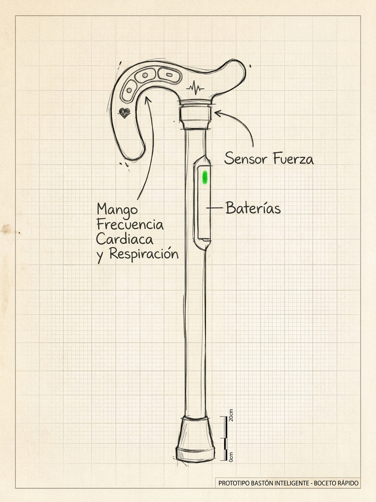

# 🦯 Bastón Vivo — Guardián del Bosque

Juego **interactivo de realidad mixta (WebXR)** que da vida al boceto del *bastón inteligente*:
cada sensor dibujado a mano se convierte en una mecánica de juego, y el entorno generado
**responde tanto a la persona como al mundo virtual** donde interactúa.



## 🎮 Cómo jugar

| Sensor del boceto | Mecánica del juego |
|---|---|
| 🖐️ **Mango — frecuencia cardíaca y respiración** | El mango mide tu agitación. Si te mueves mucho, el pulso sube (❤️ ppm en el HUD) y los espíritus se asustan. Si te quedas quieto, arranca el **Modo Calma**: un anillo guía tu respiración (inhala 4 s / exhala 6 s). 3 ciclos = **+27% batería** y desbloqueas **FLOW** (60 s de conexión total). El glifo del corazón del mango late a tu BPM real simulado. |
| 💪 **Sensor de fuerza (punta)** | Cada golpe mide su fuerza en **Newton** (HUD). Toque rápido = golpe suave; mantener pulsado = golpe cargado. Los golpes crean ondas expansivas que el bosque responde: setas que sueltan esporas, luciérnagas que acuden (o huyen), runas que se encienden… |
| 🔋 **Baterías** | Cada pulso consume batería (según fuerza). Se recarga con **chispas de energía**, **cristales** y **respiración guiada**. Sin batería el bastón se apaga. |
| 🌲 **Entorno generado** | Bosque nocturno procedural: árboles que se mecen con el viento, ráfagas periódicas (chispas x2), luciérnagas con comportamiento own (vagar/seguir/huir/bailar), espíritus fuego fatuo con humor según tu calma, rocas con cristales y un santuario de 5 runas + altar. |

**Objetivo — Vínculo con el bosque (0→100%):** despertar el bosque → revelar 3 cristales con
golpes suaves → encender las 5 runas → conectar el altar central.

## 🕶️ Modos

- **Modo 3D** — funciona en cualquier navegador de escritorio o móvil. Ratón / dedo para guiar
  el bastón, clic para golpear, mantener para cargar.
- **Realidad Mixta (AR)** — en Chrome/Android con ARCore (o visores WebXR). El bosque se
  materializa en tu habitación sobre una superficie real (hit-test); el bastón "se sostiene"
  frente a ti y golpea donde apunta el retículo. Mantén pulsada la pantalla para golpes cargados.

## 🚀 Ejecutar

```bash
node server.js        # → http://localhost:8080
# o: python3 -m http.server 8080
```

Requisitos: cualquier navegador moderno. AR: HTTPS + WebXR (`immersive-ar`).

## 🧱 Tecnología

- **Three.js** (vendido en `vendor/`, sin CDN) + **WebXR API** nativa (hit-test, dom-overlay).
- Audio 100 % sintetizado con **Web Audio API** (latidos, golpes, viento, campanas).
- Sin build ni dependencias de runtime — HTML/CSS/JS módulos planos.

## 📁 Estructura

```
index.html          entrada + HUD + overlay de inicio
css/style.css       estilos del HUD (paneles de sensores, respiración, modales)
js/main.js          bucle principal, pipeline de pulsos, modos 3D/AR
js/cane.js          modelo 3D del bastón según el boceto + física de manejo
js/world.js         bosque procedural, rocas, setas, santuario, viento
js/entities.js      luciérnagas, espíritus y chispas de energía
js/bio.js           frecuencia cardíaca y respiración simuladas (biofeedback)
js/fx.js            anillos de pulso, partículas, rayos, destellos
js/audio.js         motor de audio sintetizado
js/xr.js            sesión WebXR AR (hit-test, retículo, dom-overlay)
js/input.js         entrada de puntero en modo 3D
vendor/three/       Three.js (licencia MIT en LICENSE)
```
